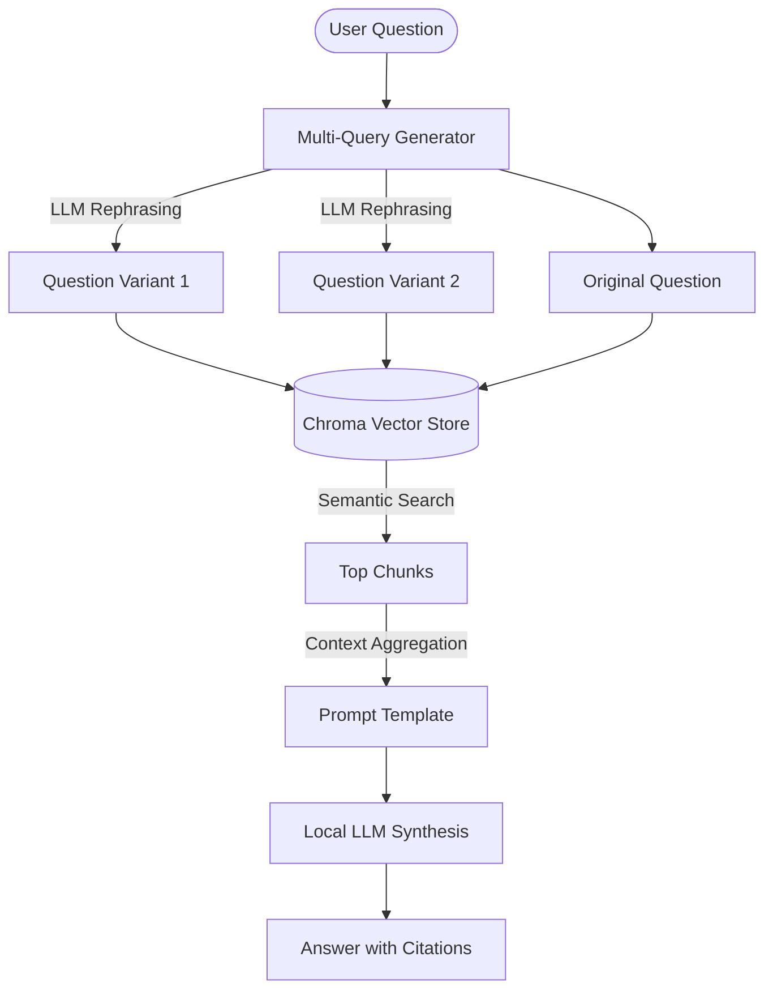
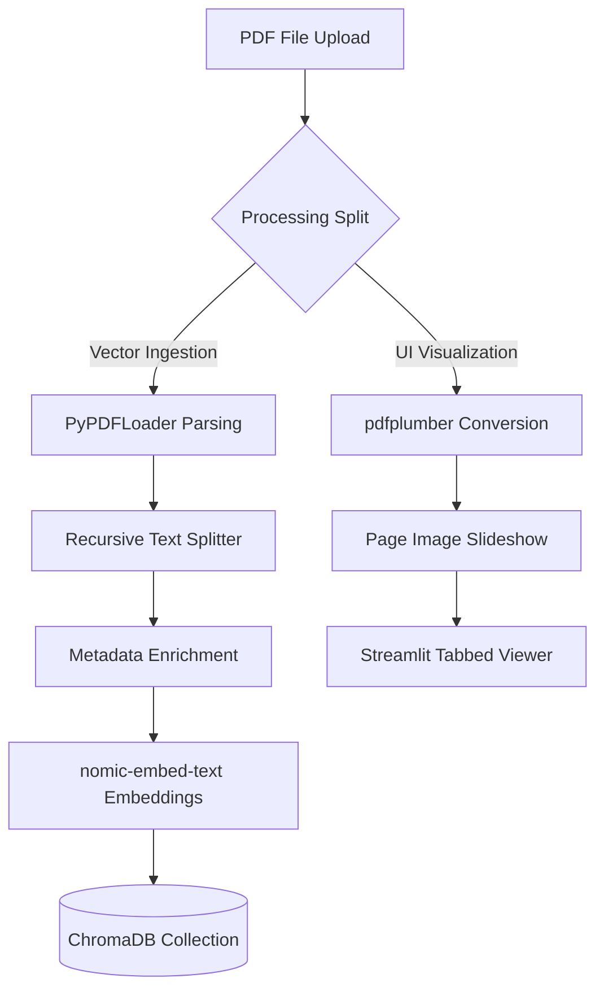

# Offline PDF RAG Pipeline

[](https://www.python.org/)
[](https://streamlit.io/)
[](https://github.com/langchain-ai/langchain)
[](https://www.trychroma.com/)
[](https://ollama.com/)
[](https://opensource.org/licenses/MIT)

A fully offline, privacy-first Retrieval-Augmented Generation (RAG) pipeline designed for local multi-document analysis. This system enables users to upload multiple PDF documents, view them side-by-side with a high-fidelity document viewer, and chat with them using locally-hosted Ollama models.

No data ever leaves your machine, and no external API keys are required.

---

## Why This Was Built

Modern cloud-based RAG solutions are powerful but present significant challenges for enterprise or local workloads:
* **Data Privacy:** Sensitive documents (intellectual property, financial audits, medical logs) are exposed to third-party endpoints.
* **API Costs:** Cloud LLMs and API-based vector stores accumulate costs rapidly as context windows scale.
* **Internet Dependency:** Cloud-dependent architectures are vulnerable to latency variations and internet drops.

This pipeline serves as a blueprint to prove that **production-ready, high-accuracy RAG can be executed entirely on consumer-grade local hardware** by leveraging optimized local LLMs, lightweight open-source embeddings, and a persistent embedded vector database.

---

## Retrieval Architecture

The pipeline processes user questions through a structured multi-query retrieval-synthesis workflow to bridge the gap between search terms and vector content:



### 1. Chunking Strategy
* **Loader:** Documents are parsed using `PyPDFLoader` to extract page-by-page content.
* **Segmentation:** Text is split using `RecursiveCharacterTextSplitter` with a `chunk_size` of **7,500 characters** and a `chunk_overlap` of **100 characters** (configured in [config.py](file:///c:/GH/pdf-rag/src/pdf_rag/config.py)).
* **Enrichment:** Chunks are annotated with robust metadata tags (`pdf_id`, `pdf_name`, `chunk_index`, and `source_file`) to support accurate multi-document source citations:
  ```json
  {
    "pdf_id": "pdf_1728394857",
    "pdf_name": "portfolio.pdf",
    "chunk_index": 4,
    "source_file": "portfolio.pdf"
  }
  ```

### 2. Embedding Model
* **Model:** `nomic-embed-text`
* Running locally via Ollama, it maps chunks into a 768-dimensional space optimized for both natural language text and code search.

### 3. Vector Database
* **Store:** `ChromaDB` (persistent)
* Collections are isolated per PDF and stored locally in the `data/vectors` directory (configured via `PERSIST_DIRECTORY` in `config.py` to `data/vectors`). This permits loading, querying, and deleting single document collections dynamically without interfering with other documents.

### 4. Multi-Query Retrieval Expansion
To overcome the limitations of cosine/distance similarity search on a single query:
1. The system uses the local LLM to generate **2 alternative phrasings** of the user's question.
2. The system executes semantic searches for **all 3 query variants** (the original plus 2 rephrasings).
3. Retrieved chunks are aggregated, deduplicated, and capped at `MAX_CONTEXT_CHUNKS = 10` to construct a comprehensive context window for final synthesis.

---

## Ingestion Pipeline

When you drop a PDF into the dashboard, a parallel dual-track ingestion process is triggered:



1. **Vector Ingestion Track:** The PDF is parsed via `PyPDFLoader`, chunked, embedded via Ollama, and written to persistent storage in the `data/vectors/` database directory.
2. **Visual Ingestion Track:** The PDF is converted into high-fidelity page images using `pdfplumber`. These images are cached in-memory and rendered dynamically in the document viewer, supporting full zoom adjustments.

---

## Configuration Settings

Global parameters are defined in [src/pdf_rag/config.py](file:///c:/GH/pdf-rag/src/pdf_rag/config.py):

| Parameter | Configuration Value | Description |
| :--- | :--- | :--- |
| `PERSIST_DIRECTORY` | `os.path.join("data", "vectors")` | Target folder for Chroma DB vector stores. |
| `EMBEDDING_MODEL` | `"nomic-embed-text"` | Ollama-hosted embedding model name. |
| `CHUNK_SIZE` | `7500` | Maximum character size of document chunks. |
| `CHUNK_OVERLAP` | `100` | Overlap character size between consecutive chunks. |
| `RETRIEVAL_K` | `3` | Number of chunks retrieved per query variant. |
| `MAX_CONTEXT_CHUNKS` | `10` | Maximum chunks aggregated into the prompt. |

---

## Example Query & Response

Here is a typical interaction querying the included academic portfolio documentation:

**User Question:**
> What is the main idea of this document?

**Assistant Response (synthesized with local `llama3.2`):**
> [!NOTE]
> The main idea of this document appears to be a guide or tutorial on creating an academic portfolio website using Next.js, Tailwind CSS, and Framer Motion. The document provides an overview of the technical skills required, design system, and features that should be included in the website, as well as motion and interaction patterns for different sections of the site.
>
> ---
> **Sources**
> * `portfolio.pdf` - 3 chunks

---

## Setup & Execution

### Prerequisites
1. **Ollama:** Download and install [Ollama](https://ollama.com/).
2. **Models:** Pull the required LLM and embedding model:
   ```bash
   ollama pull nomic-embed-text
   ollama pull llama3.2
   ```

### 1. Clone & Initialize Environment
Clone the repository, initialize your virtual environment, and install the required dependencies:

```bash
# Create and activate a virtual environment
python -m venv .venv
.venv\Scripts\activate  # On Windows
source .venv/bin/activate  # On Unix/macOS

# Install dependencies
pip install -r requirements.txt
```

### 2. Run the Application
Start the Streamlit dashboard:

```bash
streamlit run app.py
```
Open `http://localhost:8501` in your browser to interact with the interface.

---

## Directory Structure

```text
pdf-rag/
├── data/
│   └── vectors/                # Local Chroma database persistence directory
├── src/
│   └── pdf_rag/
│       ├── ui/                 # Streamlit UI modules
│       │   ├── chat.py         # Chat rendering, state updates, response synthesis
│       │   ├── pdf_viewer.py   # Page images caching and rendering slider
│       │   ├── sidebar.py      # Loaded document counts, status metrics, deletions
│       │   ├── styles.py       # Custom CSS injections and HTML badges
│       │   └── upload.py       # File dropzone & asynchronous ingestion trigger
│       ├── app.py              # Main application entry point & layout config
│       ├── config.py           # Config constants (chunk sizes, retrieval parameters)
│       ├── logging_config.py   # Global logger initializer
│       ├── ollama_client.py    # Local registry list & status helper
│       ├── pdf_processing.py   # PyPDFLoader parser, chunking, and db instantiation
│       ├── rag_chain.py        # LangChain logic, Multi-Query retrieval, and prompts
│       ├── session_state.py    # Session state validation and initialization
│       └── __init__.py
├── app.py                      # Root entry point wrapper
├── LICENSE                     # Project License
├── portfolio.pdf               # Reference PDF for validation
├── rag_notebook.ipynb          # Jupyter notebook for exploratory search experiments
└── requirements.txt            # Package dependencies
```

---

## Limitations & Trade-offs

| Limitation | Cause | Impact | Workaround |
| :--- | :--- | :--- | :--- |
| **High Initial Latency** | Multi-Query expansion makes 3 total LLM calls | Responses can take 5–15 seconds depending on hardware. | Select a smaller LLM (e.g., `llama3.2:1b` or `qwen2.5:1.5b`) or disable multi-query in code. |
| **Context Dilution** | Large chunk size (`7500` characters) | High-volume chunks can fill context windows with irrelevant surrounding text. | Reduce `CHUNK_SIZE` in `src/pdf_rag/config.py` to `1000` or `2000` for more specific retrievals. |
| **Protobuf Implementation** | Python-fallback serialization | Chroma DB operations are slightly slower due to the `PROTOCOL_BUFFERS_PYTHON_IMPLEMENTATION=python` override. | If C++ protobuf packages are compiled on your host, you can remove this configuration in `config.py`. |
| **Logical Reasoning Caps** | Small Local LLMs (1B–3B parameters) | Complex reasoning or logical cross-referencing between multiple PDFs may sometimes result in partial hallucinations. | Use larger local models like `llama3:8b` or `mistral` if your machine is equipped with dedicated VRAM (e.g., >= 8GB GPU). |

---

## License
This project is licensed under the terms of the [MIT License](file:///c:/GH/pdf-rag/LICENSE).
